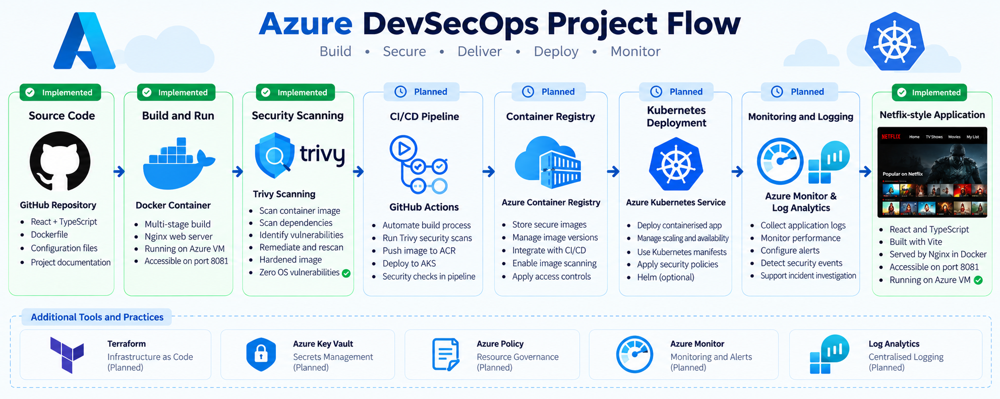
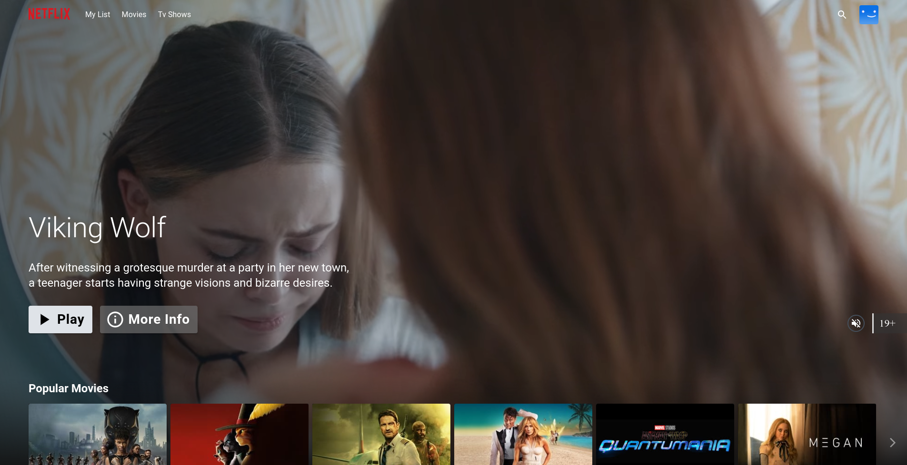
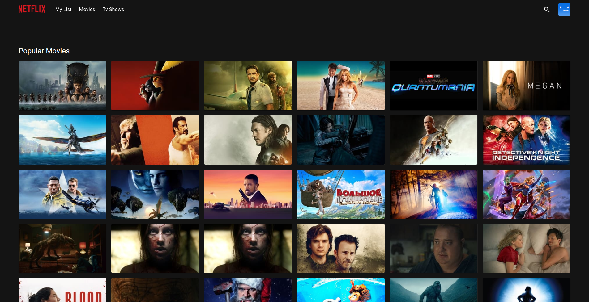
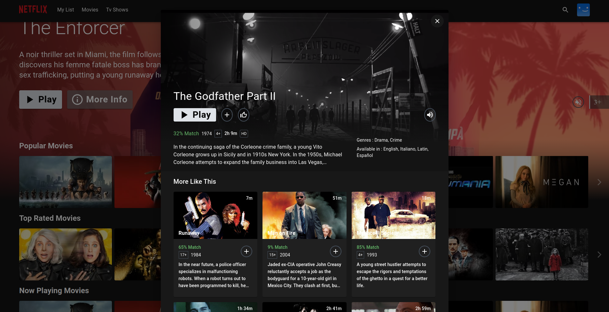
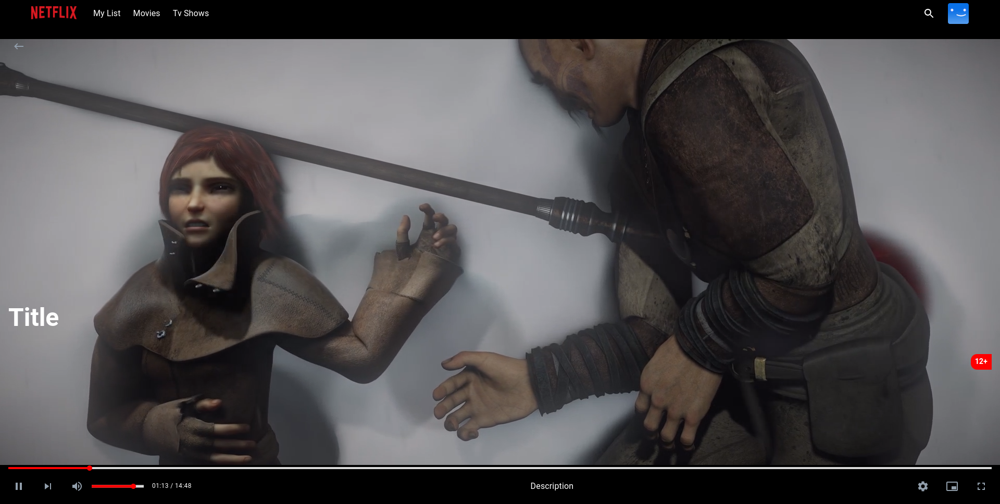

  

  **Build | Secure | Deliver | Deploy | Monitor**

  *An Azure-focused DevSecOps engineering project*

## Application Screenshots

The following screenshots show the React application used in this project.

  
  
Application Home Page

  
  
Genre Grid

  
  
Movie Details

  
  
Video Player

A hands-on DevSecOps project focused on containerisation, cloud security, vulnerability management, and secure application delivery using Microsoft Azure.

This project adapts an existing React and TypeScript Netflix-style application into an Azure-focused engineering portfolio project.

## Project Objectives

- Deploy a containerised application on an Azure Linux VM.
- Build and maintain Docker images.
- Identify and remediate container vulnerabilities.
- Scan application dependencies for known vulnerabilities.
- Manage application configuration and credentials securely.
- Introduce automated security checks through CI/CD.
- Prepare the application for future Kubernetes deployment and monitoring.

## Technology Stack

| Area | Technology |
|---|---|
| Cloud platform | Microsoft Azure |
| Operating system | Ubuntu Linux |
| Application | React and TypeScript |
| Build tool | Vite |
| Package manager | Yarn |
| Containerisation | Docker |
| Web server | Nginx |
| Vulnerability scanning | Trivy |
| Source control | Git and GitHub |
| Infrastructure as Code | Terraform (planned) |
| CI/CD | GitHub Actions (planned) |

## Architecture

1. Application source code is maintained in GitHub.
2. Docker builds the React application.
3. Nginx serves the production build.
4. Trivy scans container images and project dependencies.
5. Security findings are reviewed and remediated.
6. Future CI/CD automation will integrate security checks into the delivery workflow.

## Completed Implementation

### 1. Azure Virtual Machine Setup

- Provisioned an Ubuntu Linux virtual machine in Microsoft Azure.
- Connected to the VM using SSH.
- Installed Docker and verified that it runs successfully.

### 2. Application Containerisation

- Built a Docker image for the React application.
- Used a multi-stage Docker build.
- Used Nginx to serve the production build.
- Started the application container with host port 8081 mapped to container port 80.
- Verified the HTTP response using curl.

### 3. Container Security Assessment

- Installed Trivy for vulnerability scanning.
- Scanned the original Docker image and identified operating system vulnerabilities.
- Identified outdated Alpine Linux packages, including curl and brotli.
- Created a separate hardened Dockerfile named `Dockerfile.secure`.
- Updated Alpine packages during the hardened image build.
- Built and rescanned the hardened image.
- The recorded Trivy scan reported zero detected operating system vulnerabilities in the hardened image.

### 4. Application Dependency Assessment

- Scanned project dependencies using Trivy.
- Reviewed vulnerability findings and updated selected dependencies.
- Repeated scans to measure changes in reported vulnerabilities.

## Configuration and Secret Management

The application uses environment variables for its TMDB API configuration.

- A `.env` file is excluded from version control.
- `.env.example` provides a template for required configuration.
- Real API credentials should not be committed to GitHub.
- The Docker build context excludes local environment files through `.dockerignore`.

**Security consideration:** Vite bundles client-side environment variables into browser assets. A TMDB API key used this way must not be treated as a secret. Restrict the key where possible and consider a backend service if stronger credential protection is required.

## Security Lessons

- Vulnerability discovery should be followed by remediation and rescanning.
- Container images should use maintained base images and receive regular package updates.
- Dependency vulnerabilities must be assessed separately from operating system vulnerabilities.
- Secrets should be excluded from source control and handled carefully during builds.
- Security checks should become part of the software delivery pipeline.

## Project Roadmap

### Phase 1: CI/CD Automation
- Create a GitHub Actions workflow.
- Automate application builds.
- Integrate Trivy image and dependency scanning.
- Configure security checks before deployment.

### Phase 2: Infrastructure as Code
- Use Terraform to define Azure infrastructure.
- Manage infrastructure configuration through version control.
- Apply least-privilege access principles.

### Phase 3: Container Registry
- Create an Azure Container Registry (ACR).
- Push validated container images to ACR.
- Automate image delivery.

### Phase 4: Kubernetes Deployment
- Prepare the application for Azure Kubernetes Service (AKS).
- Configure Kubernetes deployment and service manifests.
- Apply container security and access-control practices.

### Phase 5: Monitoring
- Integrate Azure Monitor and Log Analytics.
- Configure operational and security alerts.
- Document troubleshooting and incident investigation.

## Project Status

The Azure VM deployment, Docker containerisation, and initial vulnerability remediation have been completed. CI/CD, Terraform, ACR, AKS, and monitoring remain planned stages.

This repository documents an ongoing practical engineering project. Features described as planned have not yet been implemented or verified.
